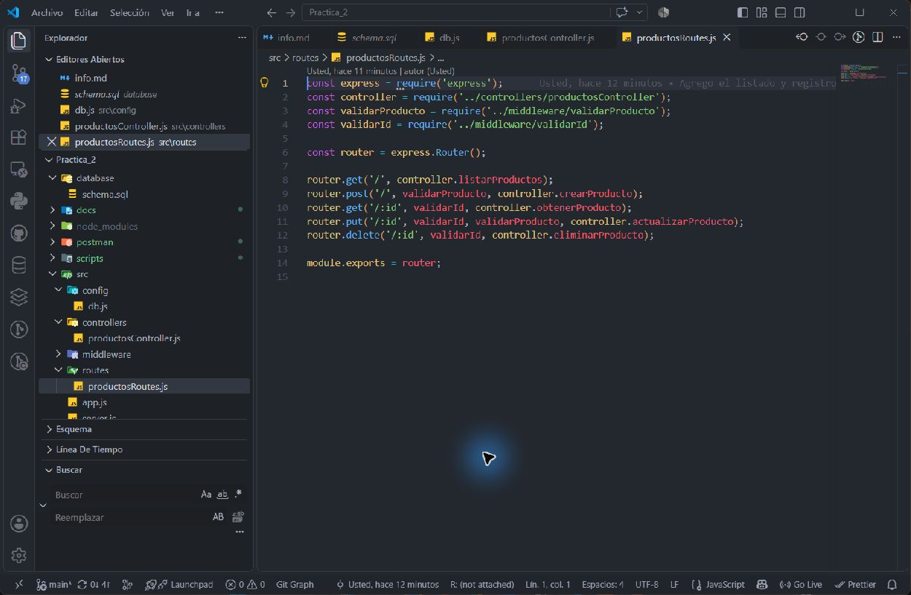
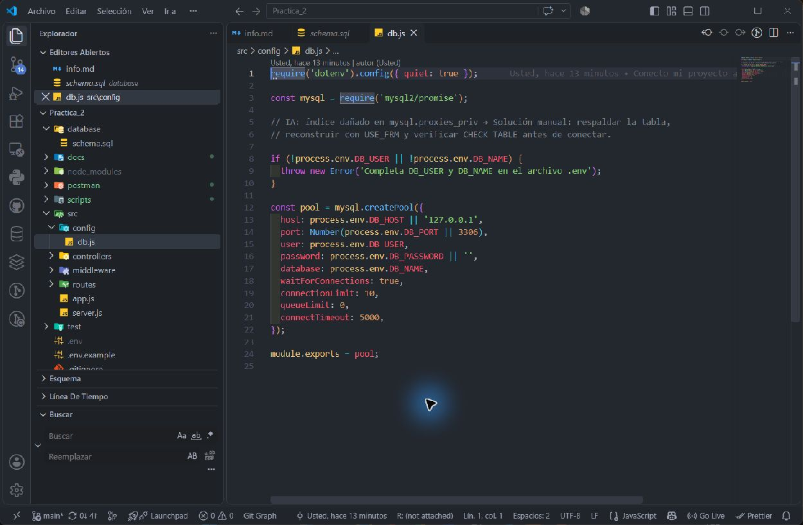
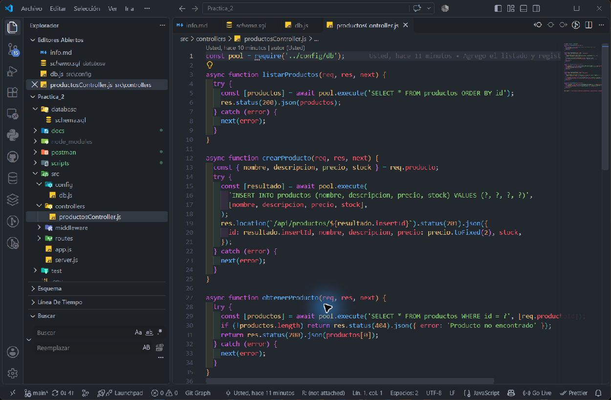
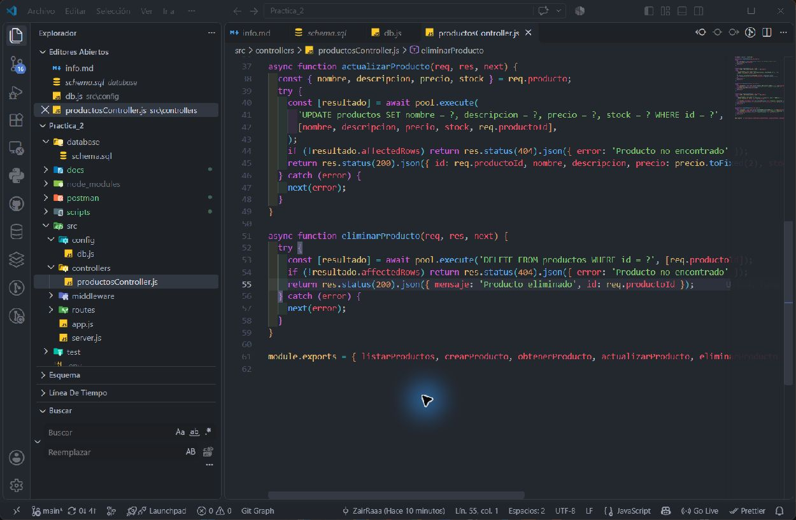
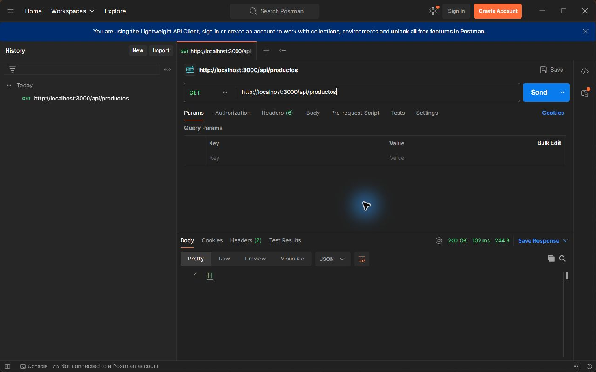
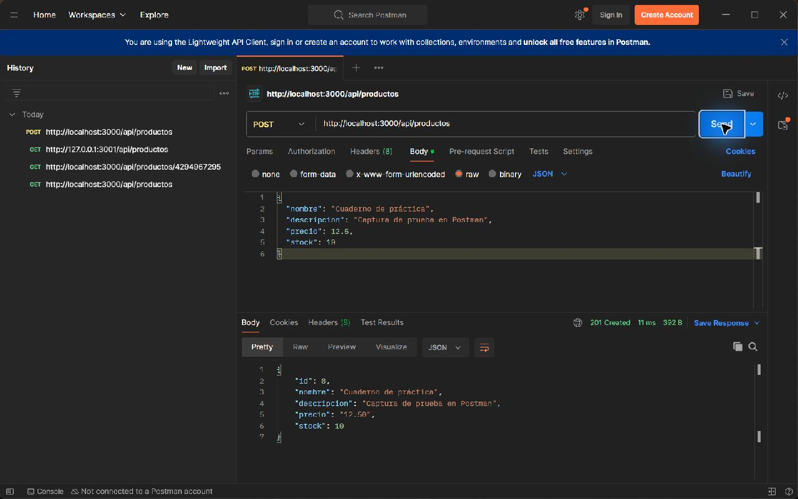
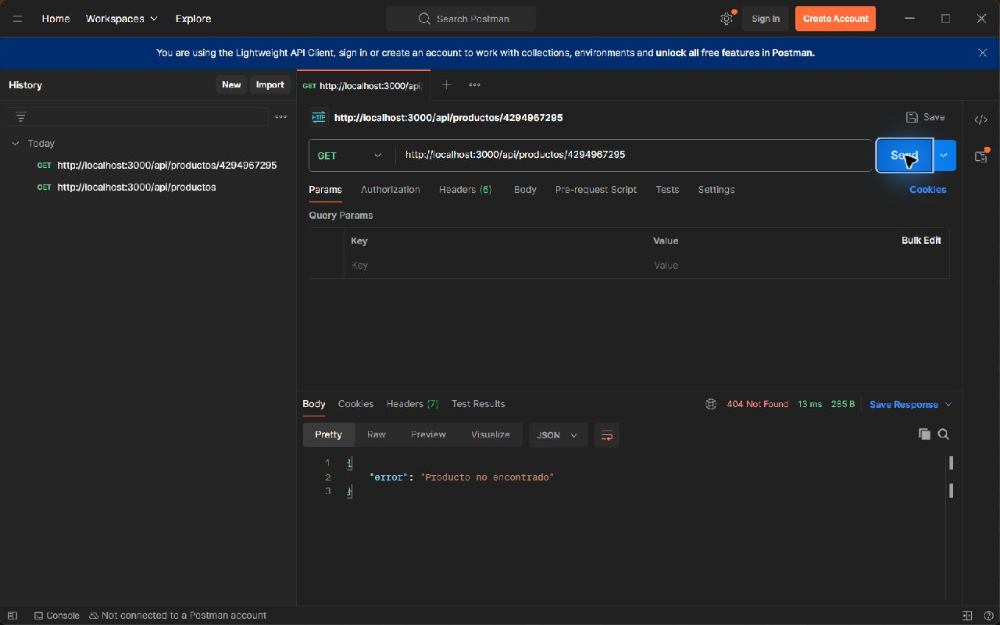
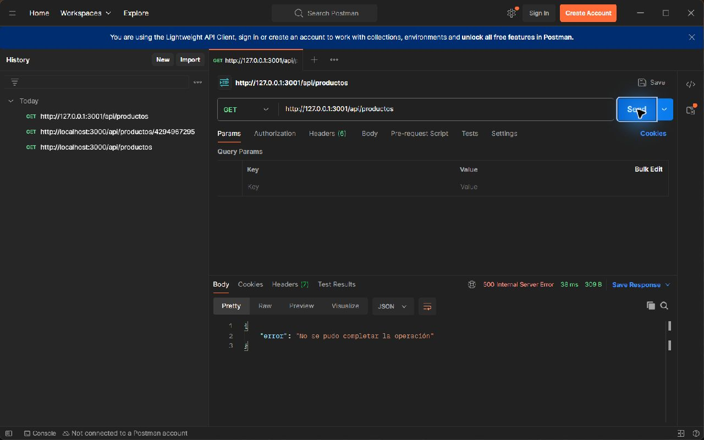

# Evidencias de la práctica

Las siguientes capturas se obtuvieron de Postman y Visual Studio Code durante
las comprobaciones reales. No contienen el contenido de `.env`.

## Estructura y rutas



## Configuración del pool



## Controlador





## Respuestas en Postman









El 500 se obtuvo desde la instancia separada de `npm run demo:error` en el
puerto 3001. La instancia principal y MySQL siguieron funcionando.
El producto creado para la captura 201 se eliminó después de obtenerla.

## Resultados verificados

- `npm test`: 11 casos dentro de una prueba principal; Node informa 12 pruebas,
  todas aprobadas. Se registraron 60 respuestas HTTP sin estados inesperados
  en [evidencias-http.json](evidencias-http.json).
- Newman, colección de productos: 11 solicitudes y 34 aserciones; 0 fallos.
- Newman, colección de error 500: 1 solicitud y 3 aserciones; 0 fallos.
- `npm run db:check`: conexión correcta y tabla disponible.

Para repetir las colecciones desde una terminal, con las instancias correspondientes
en ejecución:

```powershell
npx --yes newman run postman/productos.postman_collection.json
npx --yes newman run postman/error-500.postman_collection.json
```

## Repositorio y entrega

[Repositorio de GitHub](https://github.com/ZairRaaa/Semana_10_practica_2).
Los avances de esta sesión están en commits locales; se publican con
`git push origin main`. No se publicaron automáticamente.

La implementación se completó con asistencia de IA por solicitud del estudiante.
La autoría manual exigida por la guía debe acreditarse de acuerdo con las
indicaciones del docente; estas evidencias no prueban ese requisito.
